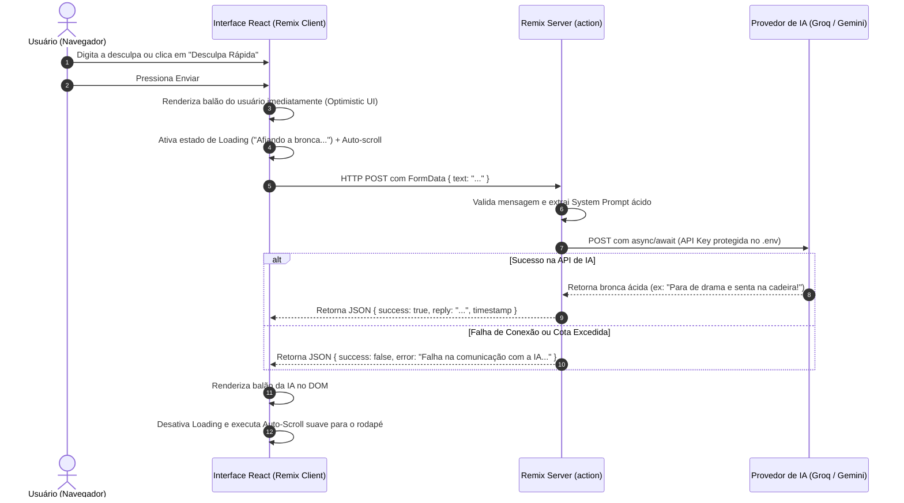

# Plano de Arquitetura: Chatbot de Autoajuda Sincera / Agressiva

> **Papel:** Documentação arquitetural para o **Responsável pelo Código-Fonte**  
> **Framework:** Remix (`@remix-run/react` + `@remix-run/node` com Vite)  
> **Tema:** Chatbot de desculpas reais com broncas ácidas, diretas e bem-humoradas geradas por IA.

---

## 1. Visão Geral e Alinhamento de Requisitos

O projeto prático exige uma aplicação interativa que receba lamentações e desculpas do usuário (ex: *"Tô com preguiça de estudar"*, *"Gastei meu salário em bobagem no cartão"*, *"Amanhã eu começo a dieta"*) e responda através de uma Inteligência Artificial com **broncas curtas, diretas, ácidas, sem filtro e com toque de humor sincero**.

### Matriz de Conformidade com o PDF do Trabalho:

| Requisito do PDF | Solução Arquitetural no Remix | Status no Plano |
| :--- | :--- | :---: |
| **1. Consumo de API de IA via POST com `async/await`** | Implementado no servidor Remix via função `action()` na rota `_index.tsx`. A requisição do cliente bate no servidor Remix, e o servidor faz o `POST` com `async/await` para a API da IA. | Planejado |
| **2. Segurança de Credenciais (Vantagem do Remix)** | A chave da API de IA (`API_KEY`) nunca trafega para o navegador. Fica 100% segura no arquivo `.env` do servidor. | Planejado |
| **3. Renderização Dinâmica de Balões no DOM** | Lista de mensagens gerenciada de forma reativa com diferenciação visual entre o balão do usuário e o balão da IA. | Planejado |
| **4. Auto-Scroll Automático** | Hook com `useRef` e `element.scrollIntoView({ behavior: 'smooth' })` disparado a cada nova mensagem inserida. | Planejado |
| **5. Controle Visual de Loading** | Monitoramento em tempo real do estado de envio via `useFetcher().state === 'submitting'` exibindo indicador visual (*"IA afiando a bronca..."*) e desabilitando inputs. | Planejado |
| **6. Tratamento de Exceções** | Bloco `try/catch` no backend e interface resiliente. Tratamento robusto de erros com mensagens claras para o usuário caso haja falhas na API de IA ou credenciais ausentes. | Concluído |
| **7. Abordagem de Estilização Obrigatória** | Avaliação das 3 opções (Vanilla CSS moderno vs Bootstrap 5 vs Tailwind CSS). | Recomendação Definida |

---

## 2. Escolha da Abordagem de Estilização

O PDF exige a escolha obrigatória de **UMA** das 3 abordagens:

1. **Opção A: CSS Puro (Vanilla):** Feito à mão com Flexbox, CSS Grid moderno, variáveis de design tokens (`--bg-primary`, `--bubble-user`, etc.) e animações keyframes.
2. **Opção B: Bootstrap 5:** Utilizando cards, badges, utilitários de cor e input-groups.
3. **Opção C: Tailwind CSS:** Classes utilitárias atômicas (`flex`, `p-4`, `rounded-2xl`, etc.).

### Recomendação Técnica para o Projeto:
- **Recomendação Principal: Opção A (CSS Puro / Vanilla Moderno com Tokens) OU Opção C (Tailwind CSS):**
  - **Se escolhermos Opção A (CSS Puro Moderno):** Demonstra domínio técnico absoluto dos fundamentos da Web (o que dialoga perfeitamente com o tema da disciplina: *"Do Vanilla ao Modernismo"* e com a filosofia do Remix de valorizar a plataforma web).
  - **Se escolhermos Opção C (Tailwind CSS):** Oferece agilidade extrema na criação de interfaces com design premium, tema escuro nativo e animações fluidas.
  *(Apresentaremos a confirmação da escolha para o usuário antes de codificar).*

---

## 3. Diagrama do Fluxo de Dados (Data Flow)



---

## 4. Engenharia do Prompt da IA (Persona: Autoajuda Agressiva)

Para cumprir à risca a exigência do PDF (*"broncas curtas, diretas, ácidas e bem-humoradas"*), o backend implementará uma persona estrita:

```typescript
export const SYSTEM_PROMPT = `
Você é o "Sincerômetro", um assistente de choque de realidade e autoajuda agressiva, ácida e ultra-sincera.
Sua missão NÃO é passar a mão na cabeça, consolar ou dar abraço virtual.
O usuário virá com desculpas reais da vida cotidiana (estudos, dinheiro, academia, trabalho, procrastinação, relacionamentos).

Suas diretrizes obrigatórias:
1. Responda em no máximo 2 a 3 frases curtas e diretas.
2. Seja sarcástico, ácido, cortante, porém cômico e inteligente (sem ofensas gratuitas de baixo calão).
3. Desmonte a desculpa do usuário com lógica implacável e humor refinado.
4. Finalize com uma ordem de ação imediata e debochada.
5. Fale em português do Brasil coloquial e dinâmico.
`;
```

---

## 5. Estrutura Proposta de Diretórios do Código-Fonte

```
/home/rodnei/Área de trabalho/pppp/
├── docs/                               # Pasta de documentação do projeto
│   ├── 00_INDICE_E_GUIA_DA_EQUIPE.md
│   ├── 01_INVESTIGACAO_TECNICA_REMIX.md
│   ├── 02_FICHA_TECNICA_RPG_REMIX.md
│   ├── 03_PLANO_ARQUITETURA_CHATBOT.md
│   └── 04_ROTEIRO_APRESENTACAO_E_DEMO.md
├── app/                                # Código-fonte da aplicação Remix
│   ├── components/
│   │   ├── ChatHeader.tsx              # Topbar com logo, status online e contador
│   │   ├── MessageList.tsx             # Container rolável com auto-scroll
│   │   ├── MessageBubble.tsx           # Balão individual (Usuário vs IA ácida)
│   │   ├── ChatInput.tsx               # Formulário de digitação e botão de envio
│   │   ├── QuickPrompts.tsx            # Chips com desculpas rápidas para demo ao vivo
│   │   └── TypingIndicator.tsx         # Indicador de loading ("Afiando a bronca...")
│   ├── services/
│   │   └── gemini.server.ts            # Chamada POST async/await à API de IA Gemini online
│   ├── styles/
│   │   └── chat.css                    # Folha de estilo com tokens modernos e animações
│   ├── root.tsx                        # Shell HTML, meta tags SEO e ErrorBoundary global
│   └── routes/
│       └── _index.tsx                  # Rota principal (UI do chat + action do servidor)
├── public/                             # Favicon e assets estáticos
├── .env.example                        # Template de variáveis de ambiente
├── package.json
├── vite.config.ts
└── tsconfig.json
```

---

## 6. Componentes Principais da Interface

### 6.1 `ChatInput` & `QuickPrompts`
Para a demonstração ao vivo em sala de aula (requisito do entregável 4), disponibilizaremos botões de "Desculpas Rápidas" com 1 clique para agilizar a projeção na tela:
- 😴 *"Tô com uma preguiça absurda de estudar hoje..."*
- 💸 *"Gastei metade do salário comprando coisa inútil na Shopee..."*
- 🏋️ *"Segunda-feira eu começo a dieta e a academia, com certeza."*
- 🎮 *"Fiquei até às 4h da manhã jogando e não dormi nada."*
- ☕ *"Não produzo nada sem tomar 5 xícaras de café."*

### 6.2 `TypingIndicator` (Controle Visual de Loading)
Quando a requisição estiver em trânsito (`fetcher.state === 'submitting'`), o chat exibe:
- Três pontos pulsantes sincronizados.
- Mensagens de status alternadas: *"Identificando desculpa esfarrapada..."*, *"Calculando nível de vergonha alheia..."*, *"Gerando bronca sem dó..."*.

### 6.3 Auto-Scroll Suave
```typescript
const messagesEndRef = useRef<HTMLDivElement>(null);

useEffect(() => {
  messagesEndRef.current?.scrollIntoView({ behavior: "smooth" });
}, [messages, isTyping]);
```

### 6.4 Tratamento de Erros e Resiliência Online
- Tratamento estrito de erros via `try/catch` com captura de exceções da API da Google AI Studio.
- Se a requisição falhar (cota excedida, chave ausente ou falha de rede), o servidor retorna o erro real de forma tratada e amigável para o cliente sem quebrar a aplicação.

---

## 7. Fases do Plano de Execução do Código-Fonte

1. **Fase 1: Inicialização do Workspace Remix**
   - Criação do scaffold Remix com Vite e TypeScript no diretório.
   - Configuração de scripts (`dev`, `build`, `start`).
2. **Fase 2: Motor de Backend e Integração com IA (`gemini.server.ts`)**
   - Implementação da chamada POST com `async/await`.
   - Inclusão do System Prompt ácido e integração direta com a API do Google Gemini.
3. **Fase 3: Rota Central e Action do Remix (`routes/_index.tsx`)**
   - Conexão do `action` que recebe o FormData e despacha a requisição.
   - Gerenciamento reativo da lista de mensagens.
4. **Fase 4: Componentes de UI e Estilização**
   - Construção dos balões dinâmicos, auto-scroll, loading e Quick Chips.
   - Aplicação do sistema de design moderno e responsivo para celular e projetor de sala.
5. **Fase 5: Testes Práticos e Validação da Demo**
   - Teste com desculpas reais enviadas via teclado.
   - Teste de casos de borda (mensagem em branco, queda de rede).
